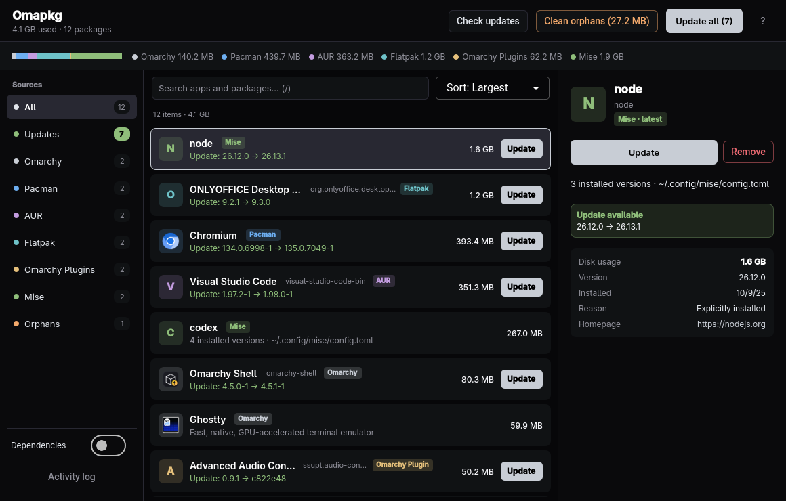

# Omapkg

Omarchy menu bar update indicator (`marciobbj.omapkg`) and native Qt Quick package & application manager for **Omarchy 4.5** — inspect disk usage, browse installed apps across **Omarchy**, **Pacman**, **AUR**, and **Flatpak**, apply updates, remove packages, and clean unused orphans, all following your active Omarchy theme and language live.



## Features

- **Omarchy menu bar widget (`marciobbj.omapkg`)** — checks installed sources for waiting updates, lights up with an accent badge when updates are available, and opens or focuses Omapkg on click (middle-click forces an immediate check).
- **Unified package sources** — Omarchy (`[omarchy]`), Pacman (`core`/`extra`/`multilib`/custom repos), AUR (`yay`), and Flatpak (automatically detected).
- **Disk usage analytics** — stacked breakdown bar per source, per-app disk usage readout, sort by largest packages, and orphan disk reclaim summary.
- **One-click maintenance** — check updates concurrently (`checkupdates`, `yay -Qua`, `flatpak remote-ls --updates`), update individual packages or update all, inspect `Depends On` / `Required By`, launch desktop apps, remove packages safely with dependency warnings, and clean unused orphans.
- **Live Omarchy theme & Hyprland rounding** — watches `~/.local/state/omarchy/current/theme/colors.toml` and `hyprctl decoration:rounding` live.
- **All 50 Omarchy 4.5 languages** — watches `~/.config/omarchy/language` live with CLDR plurals, localized disk sizes/dates/numbers, and RTL layout mirroring.
- **Headless CLI** — scriptable `list`, `updates`, and `summary` commands with `--json` output.

## Installation

### 1. Install the Omarchy bar plugin

```sh
omarchy plugin add https://github.com/marciobbj/omapkg --enable
```

The bar widget starts working immediately — it checks for waiting updates across Pacman, AUR, and Flatpak right away.

### 2. Build and install the Omapkg desktop app

On first click, if `omapkg` is not installed yet, the bar widget opens a floating terminal asking whether you want to build and install it. You can also build and install it manually at any time:

```sh
cd ~/.config/omarchy/plugins/marciobbj.omapkg
./bin/install
```

For local development without installing the Arch package:

```sh
./bin/build      # Compile with qmake6 + make into build/omapkg
./bin/test       # Build and run the Qt Test suite offscreen
```

## Removal

To cleanly remove both the bar widget and the desktop app:

```sh
# Remove the Omarchy bar plugin
omarchy plugin remove marciobbj.omapkg

# Remove the desktop app Arch package (if installed via ./bin/install)
sudo pacman -R omapkg
```

If you installed the desktop app into `~/.local` manually instead of via `pacman`, remove `~/.local/bin/omapkg`, `~/.local/share/applications/omapkg.desktop`, and `~/.local/share/icons/hicolor/scalable/apps/omapkg.svg`.

## Dependencies

### Required (for the desktop app & build)

- `qt6-base`, `qt6-declarative`, `qt6-svg`, `qt6-wayland`
- `xdg-desktop-portal`
- `expac`, `pacman-contrib` (`checkupdates`)
- `polkit` (`pkexec` for privileged package updates/removals)
- `gcc`, `make` (build-time only)

### Optional

- `yay` — AUR package updates and management
- `flatpak` — Flatpak application updates and management

## Configuration & Permissions

- Omapkg **never modifies or overwrites user configuration files** without explicit consent.
- Update checks (`checkupdates`, `yay -Qua`, `flatpak remote-ls --updates`) are read-only and run unprivileged.
- Package installation, updates, removals, and orphan cleanup are initiated only by explicit user action and authenticate through standard Polkit (`pkexec`) or `makepkg` prompts.

## Controls & Shortcuts

### Bar Widget

- **Left-click** — Open or focus Omapkg (or offer to build/install it on first run)
- **Middle-click** — Force an immediate update check
- **IPC refresh** — `omarchy-shell marciobbj.omapkg refresh` (called automatically by Omapkg after update checks and package actions)

### Desktop App

| Shortcut | Action |
| --- | --- |
| `Ctrl+F` or `/` | Focus search |
| `↑` / `↓` or `J` / `K` | Move selection |
| `Enter` / `Space` | Update selected package (or check for updates) |
| `Ctrl+U` | Update all outdated packages |
| `Ctrl+R` / `F5` | Refresh packages and check for updates |
| `Delete` / `Backspace` | Remove selected package |
| `Ctrl+Shift+O` | Clean unused orphan packages |
| `1` – `7` | Switch source tabs (All, Updates, Omarchy, Pacman, AUR, Flatpak, Orphans) |
| `L` | Toggle activity log drawer |
| `?` | Show or hide keyboard shortcuts |
| `Esc` | Close overlay or clear search |
| `Q` / `Ctrl+Q` | Quit |

## Headless CLI

```sh
omapkg summary --json
omapkg updates --json
omapkg list --json
```

## License

MIT — see [LICENSE](LICENSE).
