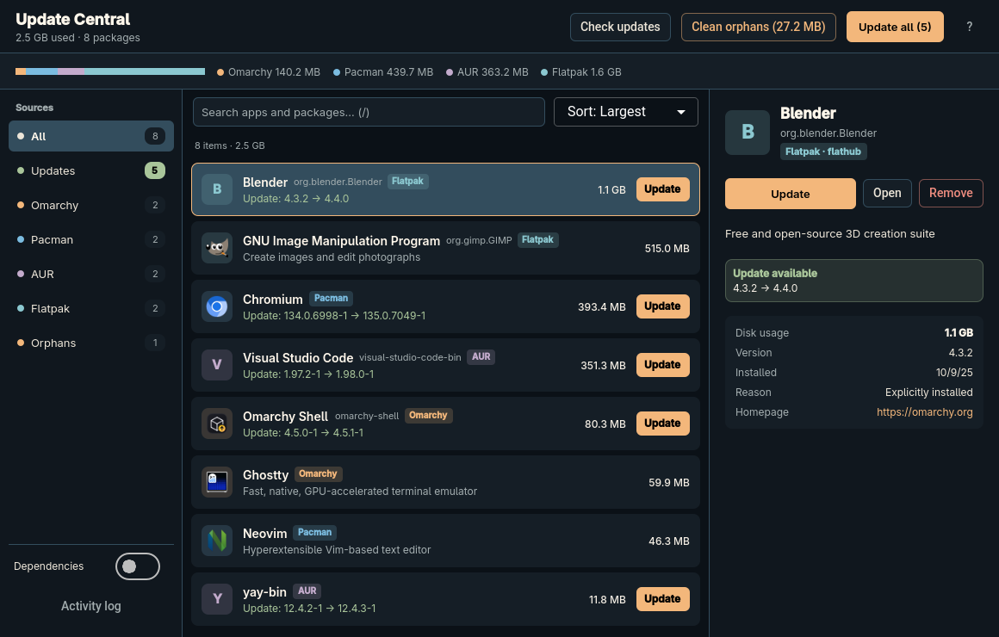

# Update Central

Native Qt Quick package and application manager for **Omarchy 4.5** — inspect disk usage, browse installed apps across **Omarchy**, **Pacman**, **AUR**, and **Flatpak**, apply updates, remove packages, and clean unused orphans, all following your active Omarchy theme and language live.



## Features

- **Unified package sources** — Omarchy (`[omarchy]`), Pacman (`core`/`extra`/`multilib`/custom repos), AUR (`yay`), and Flatpak (automatically detected).
- **Disk usage analytics** — stacked breakdown bar per source, per-app disk usage readout, sort by largest packages, and orphan disk reclaim summary.
- **One-click maintenance** — check updates concurrently (`checkupdates`, `yay -Qua`, `flatpak remote-ls --updates`), update individual packages or update all, inspect `Depends On` / `Required By`, launch desktop apps, remove packages safely with dependency warnings, and clean unused orphans.
- **Live Omarchy theme & Hyprland rounding** — watches `~/.local/state/omarchy/current/theme/colors.toml` and `hyprctl decoration:rounding` live.
- **All 50 Omarchy 4.5 languages** — watches `~/.config/omarchy/language` live with CLDR plurals, localized disk sizes/dates/numbers, and RTL layout mirroring.
- **Omarchy menu bar widget** — included in [`bar-plugin/`](bar-plugin/) (`local.omarchy-update-central`). Lights up with an accent indicator when updates are waiting and opens or focuses Update Central on click.
- **Headless CLI** — scriptable `list`, `updates`, and `summary` commands with `--json` output.

## Keyboard Shortcuts

| Shortcut | Action |
| --- | --- |
| `Ctrl+F` or `/` | Focus search |
| `↑` / `↓` or `J` / `K` | Move selection |
| `Enter` / `Space` | Update selected package (or check for updates) |
| `Ctrl+U` | Update all outdated packages |
| `Ctrl+R` / `F5` | Refresh packages and check for updates |
| `Delete` / `Backspace` | Remove selected package |
| `Ctrl+Shift+O` | Clean unused orphan packages |
| `1` – `7` | Switch source tabs (All, Updates, Omarchy, Pacman, AUR, Flatpak, Orphans) |
| `L` | Toggle activity log drawer |
| `?` | Show or hide keyboard shortcuts |
| `Esc` | Close overlay or clear search |
| `Q` / `Ctrl+Q` | Quit |

## Build, Test & Install

```sh
./bin/build      # Compile with qmake6 + make into build/omarchy-update-central
./bin/test       # Build and run the Qt Test suite offscreen
./bin/install    # Build and install the Arch package (binary, icon, .desktop)
```

## Headless CLI

```sh
omarchy-update-central summary --json
omarchy-update-central updates --json
omarchy-update-central list --json
```

## Omarchy Menu Bar Widget

To enable the menu bar update indicator:

1. Symlink `bar-plugin` into your Omarchy plugins directory:
   ```sh
   ln -s /home/io/workspace/omarchy-update-central/bar-plugin ~/.config/omarchy/plugins/local.omarchy-update-central
   ```
2. Add `{"id": "local.omarchy-update-central"}` to `bar.layout.right` in `~/.config/omarchy/shell.json`.
3. Reload the shell with `omarchy-restart-shell`.

Left-click opens or focuses Update Central; middle-click forces an immediate update check. Update Central also notifies the bar widget via `omarchy-shell local.omarchy-update-central refresh` whenever an update check or package operation finishes.

## License

MIT — see [LICENSE](LICENSE).
